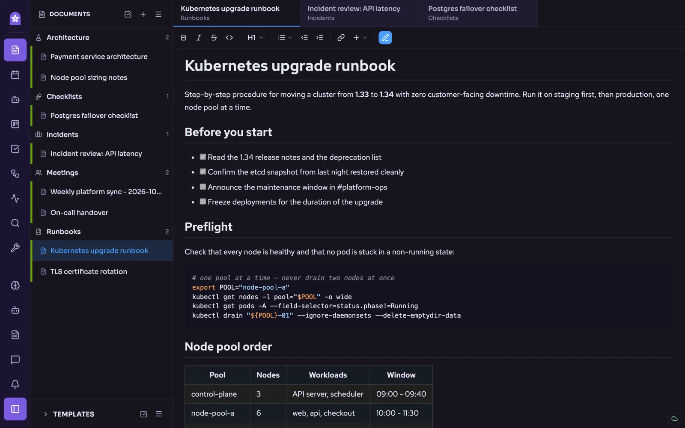
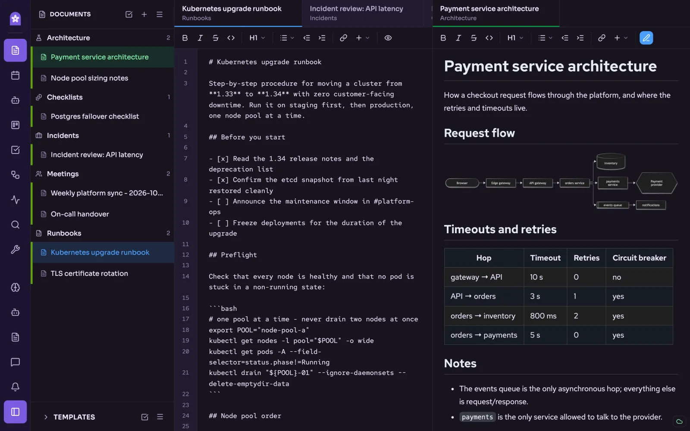
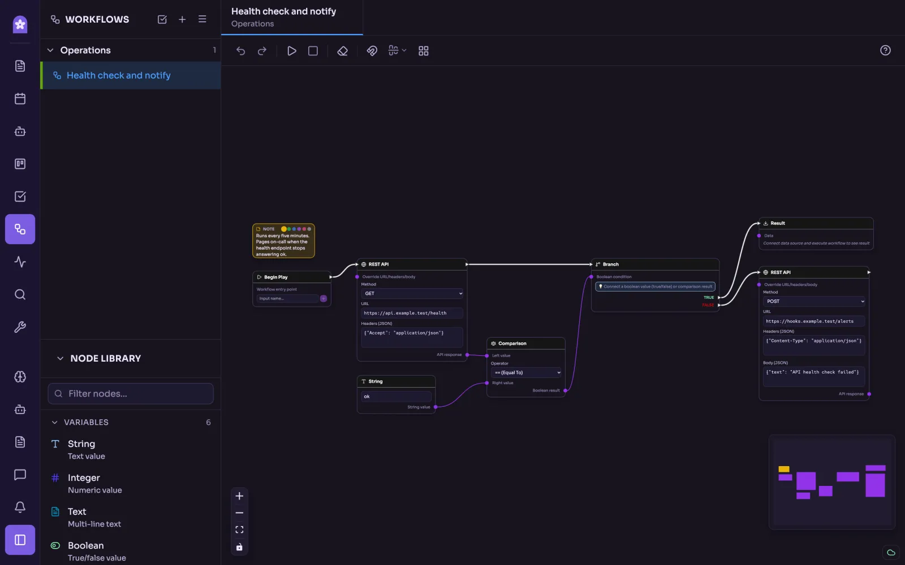
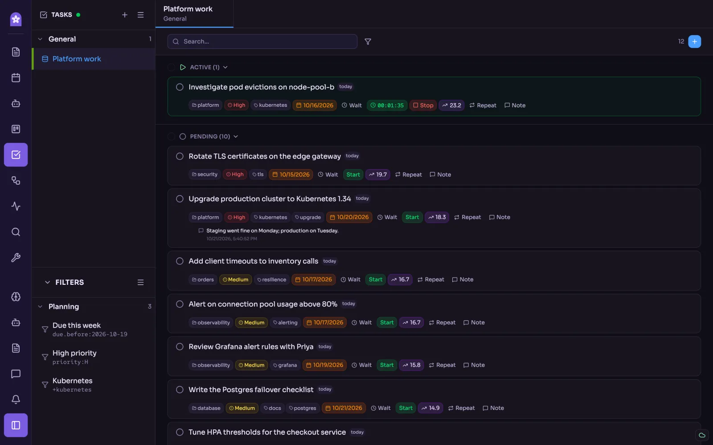
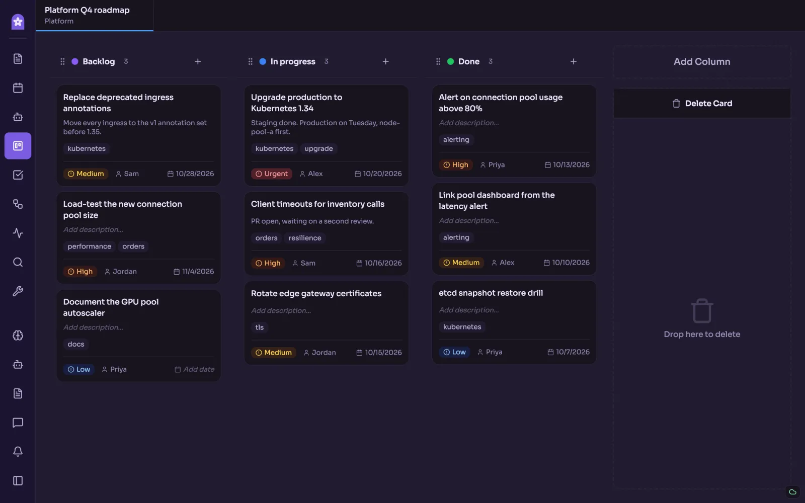
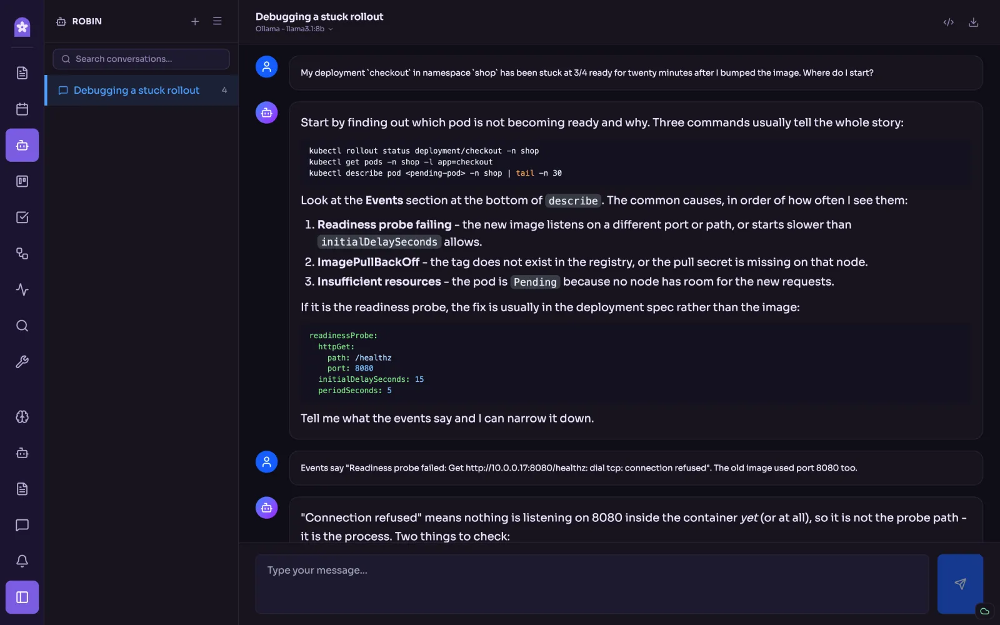
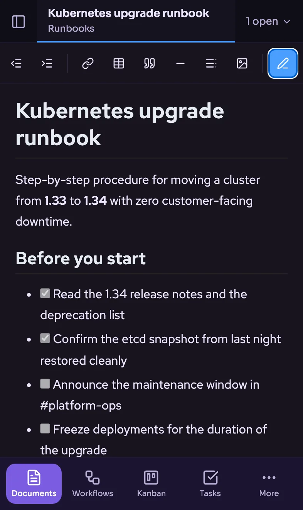

<picture>
  <source media="(prefers-color-scheme: dark)" srcset="public/brand/mark.svg">
  
</picture>

# Jacarium

Everything you know and use for technical work, in one place.

[jacarium.com](https://jacarium.com) · [AGPL-3.0 licence](LICENSE) · [Support Jacarium](#support-jacarium) · [Changelog](CHANGELOG.md)

 

> **Built by an engineer, for engineers who troubleshoot.**
>
> I created Jacarium to make troubleshooting faster. It's very opinionated,
> because it was built around my own requirements, and I'm sharing it because
> it works very well for me.
>
> — [Robin Cernin](https://github.com/zerodayz)

| | |
|---|---|
|  |  |

## What it does

Jacarium keeps your notes, cases and tools for technical work in one place,
and works offline by default.

- **Documents**: Markdown notes and runbooks with real-time collaboration,
  templates, diagrams and export to Markdown, ZIP, JSON or PDF (PDF in the
  desktop app).
- **Diagnostics**: open an sosreport and read processes, CPU and memory as
  charts, plus Kubernetes diagnostics.
- **Tasks**: Taskwarrior tasks with projects, priorities, due dates and
  saved filters.
- **Kanban**: boards for roadmaps and day-to-day work.
- **Workflows**: a visual workflow builder: REST calls, SSH, conditions,
  loops and transformations, wired together on a canvas.
- **Robin**: an AI chat for debugging, with your own model provider.
- **And more**: Jira search, calendars, quizzes and tools.
- **On a phone**: you can open a self-hosted Jacarium in your phone's
  browser, but it isn't optimised for mobile: it's the web app in a smaller
  browser window.

| | |
|---|---|
|  |  |
|  |  |
|  | |

## Two ways to run it

**Desktop app.** Download the app, run it, write your first note.
Get it from the [latest release](https://github.com/jacarium/jacarium/releases/latest):

| System | File |
|---|---|
| macOS, Apple silicon (M1 and later) | `Jacarium-<version>-arm64.dmg` |
| Linux, x64 | `Jacarium-<version>.AppImage`, `jacarium_<version>_amd64.deb` or `jacarium-<version>.x86_64.rpm` |
| Linux, ARM64 | `Jacarium-<version>-arm64.AppImage`, `jacarium_<version>_arm64.deb` or `jacarium-<version>.aarch64.rpm` |

- **Intel Macs**: there is no desktop download (a library the AI document
  search needs is only built for Apple silicon); use a self-hosted Jacarium
  in your browser instead.
- **macOS**: the app isn't signed by Apple yet, so the first time macOS says
  it can't be opened. Open **System Settings > Privacy & Security** and click
  **Open Anyway** next to Jacarium.
- **Linux**: make the AppImage executable (`chmod +x Jacarium-*.AppImage`)
  and run it, or install the package: `sudo apt install ./jacarium_*.deb`
  (Debian, Ubuntu) or `sudo dnf install ./jacarium-*.rpm` (Fedora, RHEL).
  The Linux builds need a recent distribution: Ubuntu 24.04, Debian 13,
  Fedora 40, RHEL 10 or newer.
- **Verify your download**: each release lists the files' SHA-256 checksums
  in `SHA256SUMS.txt`, and GitHub records where each file was built:
  `gh attestation verify <file> --repo jacarium/jacarium`.

You can also build it from source: [docs/DEVELOPMENT.md](docs/DEVELOPMENT.md).

**Self-hosted.** Deploy the container on your own server, such as a
Raspberry Pi, open it in your web browser, write your first note. A home
server also keeps your devices in sync: [docs/SELF_HOSTING.md](docs/SELF_HOSTING.md).

More about the desktop app (profiles, Google Calendar, the connection
indicator): [docs/DESKTOP.md](docs/DESKTOP.md).

## Built with security in mind

As an engineer and DevSecOps Certified AI Security Professional, currently
working towards becoming a Software Supply Chain Security Expert, I make
security the priority in this app.

1. **Scanning and updates.** Jacarium is continuously scanned against known
   vulnerabilities and continuously updated. Its own code is checked too,
   not only the packages it relies on.
2. **Dependency checks.** Every dependency is checked, and so are their
   dependencies: scanned for end-of-life software and verified against
   their code licenses.
3. **Test-driven development.** Jacarium is built test-first: tests are
   written before the code they cover.

Found a security issue? Please report it privately, as described in
[SECURITY.md](SECURITY.md).

## Your notes stay on your infrastructure

Jacarium is offline by default.

- **Where your data lives**: in your browser first; with a home server on
  your Raspberry Pi.
- **What we collect**: nothing.
- **Export and backups**: export to Markdown, ZIP, JSON or PDF at any time
  (PDF in the desktop app).

**Important**

- For access away from home, connect to your home server through your own VPN.
- Traffic is encrypted, but stored data isn't, so use disk encryption such
  as FileVault or LUKS.
- You run and secure it yourself, without warranty under the AGPL-3.0 licence.

## Support Jacarium

Jacarium is free and open source. If it saves you time, you can support its
development:

- [Leave a tip on Ko-fi](https://ko-fi.com/robincernin)
- [Sponsor on GitHub](https://github.com/sponsors/zerodayz)

Found a bug or have an idea? [Open an issue](https://github.com/jacarium/jacarium/issues).

## For developers

- [Development and building](docs/DEVELOPMENT.md)
- [Developer guides](docs/README.md): adding a page, a tool or a game mode,
  and how to release
- [Changelog](CHANGELOG.md)

## Licence

Copyright (C) 2026 Robin Cernin

This program is free software: you can redistribute it and/or modify it under
the terms of the GNU Affero General Public License as published by the Free
Software Foundation, version 3.

This program is distributed in the hope that it will be useful, but WITHOUT ANY
WARRANTY; without even the implied warranty of MERCHANTABILITY or FITNESS FOR A
PARTICULAR PURPOSE. See the GNU Affero General Public License for more details.

You should have received a copy of the GNU Affero General Public License along
with this program (the [LICENSE](LICENSE) file). If not, see
<https://www.gnu.org/licenses/>.

The fonts (Red Hat Text, Red Hat Mono, Sora) are under the
[SIL Open Font License](https://openfontlicense.org); the workflow canvas is
[React Flow](https://reactflow.dev) (MIT).
